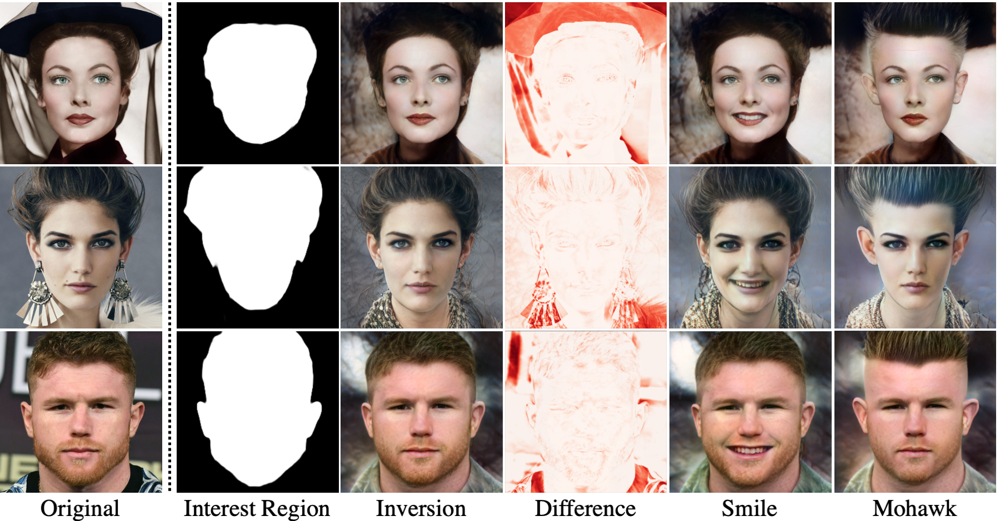

## IntereStyle: Encoding an Interest Region for Robust StyleGAN Inversion

<div align="center">
    
  </div>

[**IntereStyle: Encoding an Interest Region for Robust StyleGAN Inversion**](https://arxiv.org/abs/2209.10811) <br>
[SeungJun Moon](https://seungjun-moon.github.io/tabs/about.html) [Gyeong-Moon Park](https://gyeongmoon.github.io/)

**Abstract** : Recently, manipulation of real-world images has been highly elaborated along with the development of Generative Adversarial Networks (GANs) and corresponding encoders, which embed real-world images into the latent space. However, designing encoders of GAN still remains a challenging task due to the trade-off between distortion and perception. In this paper, we point out that the existing encoders try to lower the distortion not only on the interest region, e.g., human facial region but also on the uninterest region, e.g., background patterns and obstacles. However, most uninterest regions in real-world images are located at out-of-distribution (OOD), which are infeasible to be ideally reconstructed by generative models. Moreover, we empirically find that the uninterest region overlapped with the interest region can mangle the original feature of the interest region, e.g., a microphone overlapped with a facial region is inverted into the white beard. As a result, lowering the distortion of the whole image while maintaining the perceptual quality is very challenging. To overcome this trade-off, we propose a simple yet effective encoder training scheme, coined IntereStyle, which facilitates encoding by focusing on the interest region. IntereStyle steers the encoder to disentangle the encodings of the interest and uninterest regions. To this end, we filter the information of the uninterest region iteratively to regulate the negative impact of the uninterest region. We demonstrate that IntereStyle achieves both lower distortion and higher perceptual quality compared to the existing state-of-the-art encoders. Especially, our model robustly conserves features of the original images, which shows the robust image editing and style mixing results.

---

## Setup

**Clone and install dependencies:**

```bash
git clone https://github.com/seungjun-moon/interestyle.git
cd interestyle
pip install torch torchvision lpips dlib tqdm tensorboard
```

**Pretrained models** should be placed under `pretrained_models/`:

| Model | Path |
|---|---|
| StyleGAN2 FFHQ (1024×1024) | `pretrained_models/stylegan2-ffhq-config-f.pt` |
| IR-SE50 (for ID loss) | `pretrained_models/model_ir_se50.pth` |
| CurricularFace backbone | `pretrained_models/CurricularFace_Backbone.pth` |
| ResNet-34 | `pretrained_models/resnet34-333f7ec4.pth` |
| MoCo v2 (for MoCo loss) | `pretrained_models/moco_v2_800ep_pretrain.pth.tar` |
| dlib shape predictor | `pretrained_models/shape_predictor_68_face_landmarks.dat` |
| MTCNN (pnet/rnet/onet) | `pretrained_models/mtcnn/` |

Set dataset paths in `configs/paths_config.py` before training.

---

## Data Preparation

**Face alignment** (FFHQ-style preprocessing):

```bash
python scripts/align_faces_parallel.py \
    --num_threads 4 \
    --root /path/to/raw/images \
    --output_root /path/to/aligned/images
```

**Mask generation** for interest region:

```bash
python scripts/generate_mask.py \
    --data_path /path/to/aligned/images \
    --output_path /path/to/masks
```

---

## Training

Train the IntereStyle encoder (pSp-based) on FFHQ:

```bash
python scripts/train_restyle_psp.py \
    --exp_dir=/path/to/experiment \
    --dataset_type=ffhq_encode \
    --encoder_type=BackboneEncoder \
    --input_nc=6 \
    --n_iters_per_batch=5 \
    --batch_size=4 \
    --learning_rate=0.0001 \
    --optim_name=ranger \
    --lpips_lambda=0.8 \
    --l2_lambda=1.0 \
    --id_lambda=0.1 \
    --w_norm_lambda=0.0 \
    --max_steps=500000 \
    --stylegan_weights=pretrained_models/stylegan2-ffhq-config-f.pt \
    --apply_mask_loss
```

Resume from a checkpoint:

```bash
python scripts/train_restyle_psp.py \
    --exp_dir=/path/to/experiment \
    ... \
    --checkpoint_path=/path/to/checkpoint.pt
```

**Key training options:**

| Argument | Default | Description |
|---|---|---|
| `--exp_dir` | — | Output directory for checkpoints and logs |
| `--dataset_type` | `ffhq_encode` | Dataset type (`ffhq_encode`, `cars_encode`, etc.) |
| `--encoder_type` | `BackboneEncoder` | Encoder architecture |
| `--n_iters_per_batch` | `5` | Number of iterative refinement steps |
| `--batch_size` | `4` | Training batch size |
| `--lpips_lambda` | `0` | Weight for LPIPS perceptual loss |
| `--l2_lambda` | `0` | Weight for L2 pixel loss |
| `--id_lambda` | `0` | Weight for identity loss |
| `--moco_lambda` | `0` | Weight for MoCo feature loss |
| `--w_norm_lambda` | `0` | Weight for W-norm regularization |
| `--apply_mask_loss` | `False` | Enable interest-region masked loss (IntereStyle) |
| `--max_steps` | `500000` | Total training steps |
| `--start_from_latent_avg` | `False` | Initialize codes from the mean latent |

Training logs are written to TensorBoard under `<exp_dir>/logs/`.

---

## Inference

Run iterative inversion on a folder of images:

```bash
python scripts/inference_iterative.py \
    --exp_dir=/path/to/output \
    --checkpoint_path=/path/to/checkpoint.pt \
    --data_path=/path/to/images \
    --test_batch_size=4 \
    --n_iters_per_batch=5
```

Save results with original image coupled side-by-side:

```bash
python scripts/inference_iterative_save_coupled.py \
    --exp_dir=/path/to/output \
    --checkpoint_path=/path/to/checkpoint.pt \
    --data_path=/path/to/images \
    --test_batch_size=4 \
    --n_iters_per_batch=5
```

Inversion from a saved latent code:

```bash
python scripts/inference_latent.py \
    --exp_dir=/path/to/output \
    --checkpoint_path=/path/to/checkpoint.pt \
    --data_path=/path/to/images \
    --test_batch_size=4 \
    --n_iters_per_batch=5
```

Encoder bootstrapping (two-stage inference):

```bash
python scripts/encoder_bootstrapping_inference.py \
    --exp_dir=/path/to/output \
    --model_1_checkpoint_path=/path/to/model1.pt \
    --model_2_checkpoint_path=/path/to/model2.pt \
    --data_path=/path/to/images \
    --test_batch_size=4 \
    --n_iters_per_batch=5
```

Results are saved under `<exp_dir>/inference_results/` with one subdirectory per refinement iteration. Latent codes are saved as `<exp_dir>/latents.npy`.

**Key inference options:**

| Argument | Default | Description |
|---|---|---|
| `--checkpoint_path` | — | Path to trained model checkpoint |
| `--data_path` | `gt_images` | Directory of input images |
| `--n_iters_per_batch` | `5` | Number of iterative refinement steps |
| `--n_images` | `None` | Limit number of images (None = all) |
| `--resize_outputs` | `False` | Resize outputs to 256×256 |

---

## Project Structure

```
interestyle/
├── configs/
│   ├── data_configs.py          # Dataset configurations
│   ├── paths_config.py          # Dataset and model paths
│   └── transforms_config.py     # Image transforms
├── criteria/
│   ├── id_loss.py               # Identity loss
│   ├── moco_loss.py             # MoCo feature loss
│   ├── w_norm.py                # W-norm regularization
│   └── lpips/                   # LPIPS perceptual loss
├── datasets/
│   ├── images_dataset.py        # Training dataset
│   ├── inference_dataset.py     # Inference dataset
│   └── gt_res_dataset.py        # Ground-truth / residual dataset
├── models/
│   ├── psp.py                   # pSp encoder (main model)
│   ├── e4e.py                   # e4e encoder variant
│   ├── encoders/                # Encoder backbones
│   ├── e4e_modules/             # e4e discriminator / pool
│   ├── mtcnn/                   # MTCNN face detector
│   └── stylegan2/               # StyleGAN2 generator
├── options/
│   ├── train_options.py         # Training arguments
│   ├── test_options.py          # Inference arguments
│   └── e4e_train_options.py     # e4e-specific training arguments
├── scripts/
│   ├── train_restyle_psp.py     # Main training script (pSp)
│   ├── train_restyle_e4e.py     # Training script (e4e)
│   ├── inference_iterative.py   # Iterative inversion
│   ├── inference_iterative_save_coupled.py
│   ├── inference_latent.py      # Inversion from latent
│   ├── encoder_bootstrapping_inference.py
│   ├── align_faces_parallel.py  # Face alignment preprocessing
│   └── generate_mask.py         # Interest-region mask generation
├── training/
│   ├── coach_restyle_psp.py     # Training loop
│   └── ranger.py                # Ranger optimizer
├── utils/
│   ├── common.py
│   ├── data_utils.py
│   ├── inference_utils.py
│   ├── mask_utils.py
│   ├── model_utils.py
│   └── train_utils.py
└── assets/
    └── teaser.png
```

---

## Citation

```bibtex
@article{moon2022interestyle,
  title={IntereStyle: Encoding an Interest Region for Robust StyleGAN Inversion},
  author={Moon, SeungJun and Park, Gyeong-Moon},
  journal={arXiv preprint arXiv:2209.10811},
  year={2022}
}
```
